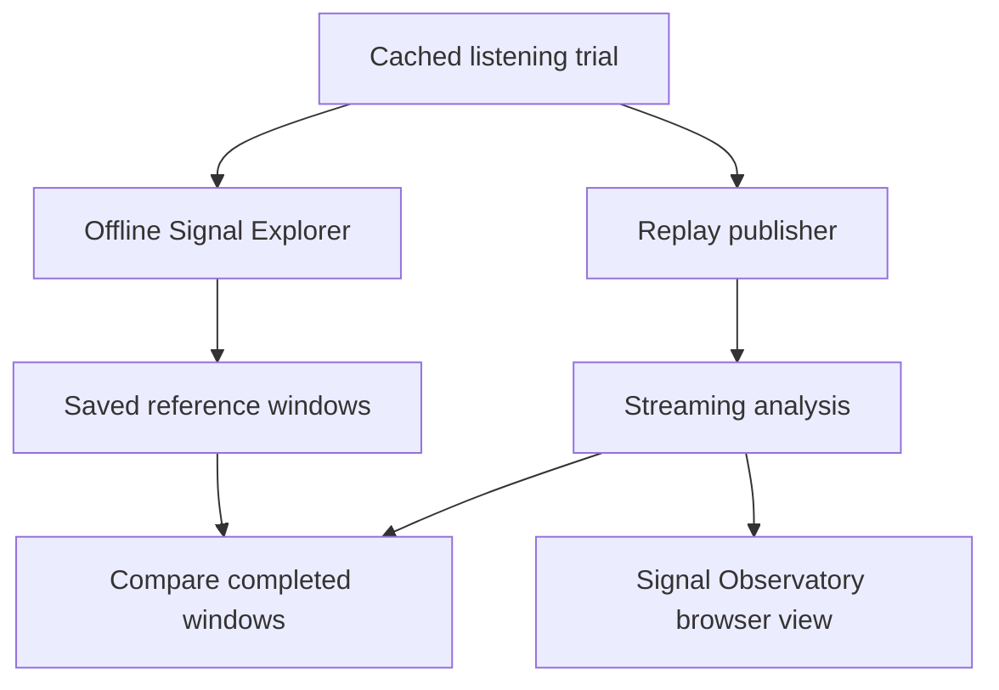

# 4. Solution Strategy

Raisync will analyze one OpenMIIR listening trial twice. First, the Signal Explorer will read the complete recording and save a reproducible reference result. Then the Signal Observatory will receive the same audio and EEG samples in timestamped chunks and compute features as the trial unfolds. Keeping the inputs and analysis settings fixed makes it possible to test what changes when data arrives incrementally.

## 4.1 Establish the offline reference

The first milestone is a local Python command-line run. It pairs the selected EEG trial with its musical excerpt, locates the start of the music after the cue clicks, and uses that point as time zero. If the timing evidence is insufficient, the run reports which marker or offset is missing. A synthetic signal with a known offset tests the alignment independently of the real trial.

The run saves the synchronized plot and a machine-readable reference. For each time window, the reference records its boundaries, the selected EEG channel, envelope values, and detected onset times. It also identifies the source files, timing uncertainty, code version, and analysis settings. The baseline is ready for replay testing when a reviewer can reproduce those outputs from cached inputs on a laptop. [Local execution constraints](02-constraints.md#21-local-first-execution)

## 4.2 Process the recording incrementally

At normal speed, the publisher releases each chunk when the replay clock reaches the end of that chunk in the recording. Each chunk identifies its trial, signal, sample range, and recording time. The processor uses recording time to assign samples to windows. A late EEG chunk therefore changes when a result becomes available, while the EEG retains its original position relative to the music.

Both modes use the same feature definitions, window boundaries, and rules for the end of the trial. Features used for comparison must be computable from the samples released so far. For example, if an onset detector needs later samples to confirm a peak, both modes use the same look-ahead. Replay waits for those samples and counts the wait toward latency. The browser displays completed results under the public audio conditions defined in [chapter 3](03-context-and-scope.md#32-technical-context).

A local Kafka-compatible broker is a candidate when the publisher and processor run separately. It would let a reviewer pause the processor, accumulate a backlog, and observe recovery. The offline command and its saved reference remain usable on their own.

## 4.3 Verify the transition

| Question | Evidence from the replay |
| --- | --- |
| Does splitting the recording into chunks change the result? | Replay the reference trial with different chunk sizes, including a split through a detected onset. Match each completed window to the baseline by trial, channel, and window boundaries. Event counts must match exactly and numerical features must agree within a documented tolerance for each feature. |
| Can a reviewer interrupt and resume the run? | For one short trial, restart from its beginning to rebuild filter state and partial windows. On retry, replace each window’s previous result using its stable key (run, trial, channel, and window boundaries). Compare the final set with the uninterrupted run to check for missing or duplicate results. |
| Does the browser receive results on time? | At 1× replay, measure the delay from each window’s scheduled end to the time its result becomes available to the browser. The target is at least 95% of windows within one second. For example, a window ending at 5.0 seconds and available at 5.3 seconds has 300 ms of delay. [Quality goals](01-introduction-and-goals.md#12-quality-goals) |
