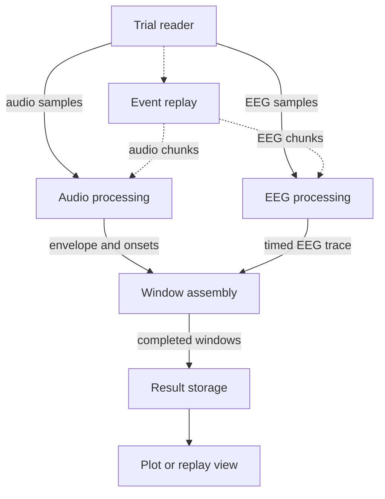
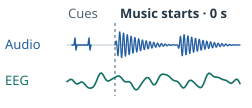
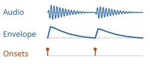
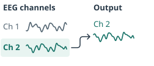
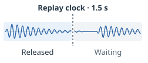
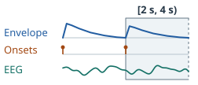
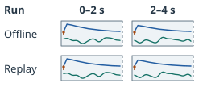

# 5. Building Block View

## 5.1 Raisync at a glance

The Signal Explorer will analyze one cached OpenMIIR listening trial on a laptop. The later Signal Observatory will add a replay publisher ahead of the same audio and EEG processors. Sharing those processors makes it possible to test whether delivering a recording in chunks changes the result. These are planned software modules that can run in one Python process.

Solid arrows show the offline path. Dashed arrows show how replay will deliver samples to the same processors.

The diagrams follow the same schematic excerpt. Time runs left to right along each trace.

| Building block | Responsibility and interface | Diagram |
| --- | --- | --- |
| Trial reader | Selects the listening trial from the participant EEG file (FIF) and verifies the matching OpenMIIR inputs as described below. It maps audio and EEG sample positions to seconds from the start of the music after the cue clicks. It passes the timing marker, offset, uncertainty, and expected sample ranges for the excerpt to the analysis. If it cannot locate the start of the music, it reports the missing evidence and stops. |  |
| Audio processing | Takes audio samples and their sampling rate. Produces a time-stamped amplitude envelope and one timestamp per detected musical onset. Carries detector state across chunks so a note attack spanning two chunks is counted once. |  |
| EEG processing | Takes EEG samples, channel metadata, and the requested channel. Buffers out-of-order chunks until the next contiguous sample range is available. Any configured filter processes that range in recording order and carries its state across chunks. Returns the selected channel’s values, units, and trial-relative timestamps at the original EEG sampling rate. |  |
| Event replay | Reads the trial in recording order and releases each chunk when the replay clock reaches its end. Each chunk identifies the trial, signal, sample range, and recording time. The first milestone reads directly from the trial reader. A Kafka-compatible broker remains an option if publisher and processor later run separately. |  |
| Window assembly | Groups both processors’ outputs by trial and recording-time interval. It closes a window when both streams cover the expected interval and the onset detector has resolved the window’s candidates. Both modes apply the end-of-trial rule below. |  |
| Result storage | Saves completed windows and run metadata locally. Exposes the offline reference and each replay run separately so a reviewer can compare them. |  |

OpenMIIR used stimulus revision **v1 for P01–P08** and **v2 for P09–P14**. Before aligning a trial, the reader checks that the cached full stimulus, its cue information, and the stimulus metadata match the participant’s revision and the trial’s stimulus ID. A mismatch stops the run and identifies the conflicting input. The verified stimulus and its cue offset determine the musical excerpt’s duration, excluding the cue. [OpenMIIR audio revisions](https://github.com/sstober/openmiir/tree/master/audio) · [OpenMIIR stimulus metadata](https://github.com/sstober/openmiir/tree/master/meta)

The local command line selects the trial and channel and renders the reference plot. The later browser view reads completed replay windows and shows processing delay separately from recording time. Public audio playback follows the [dataset constraints](02-constraints.md#23-dataset-licensing).

## 5.2 Window and storage interfaces

**Window boundaries.** A window includes its start and excludes its end. An onset at exactly 2.000 seconds belongs to the window beginning at 2.000 seconds, even if the detector confirms it in the next chunk. Each numerical window stores recording-time coordinates for its EEG samples and envelope frames, either as timestamps or as a time origin and spacing for each regular series.

**End of trial.** Both modes schedule windows from time zero to the verified excerpt duration `T`, using the configured window width. If the last window is short, it ends at `T`. If a full window ends at `T`, it is the last one. The reader determines the expected sample range for each signal from its own time grid over `[0, T)`. When both streams end, window assembly checks those ranges. A gap leaves the affected windows open and the run incomplete.

Once the audio processor has received the full expected audio range, it resolves pending onsets using the recorded samples. It retains confirmed events and discards candidates whose required look-ahead extends past the available audio. This applies to candidates in any still-open window.

**Run storage.** Source recordings stay in the local input cache. Each run saves its source identifiers, verified stimulus revision, selected channel, alignment evidence, code version, and analysis settings alongside its numerical windows. The Signal Explorer also saves the plot. The numerical windows are the reference for replay comparisons.

**Retry and comparison.** Storage identifies a result by run, trial, channel, and window boundaries. Restarting an interrupted replay from the beginning reuses its run ID and replaces the corresponding windows. Comparing a replay with the offline reference pairs windows across their two run IDs by trial, channel, and boundaries, then checks onset counts and times, the time coordinates of EEG samples and envelope frames, and their values. [Solution strategy](04-solution-strategy.md#43-verify-the-transition)
