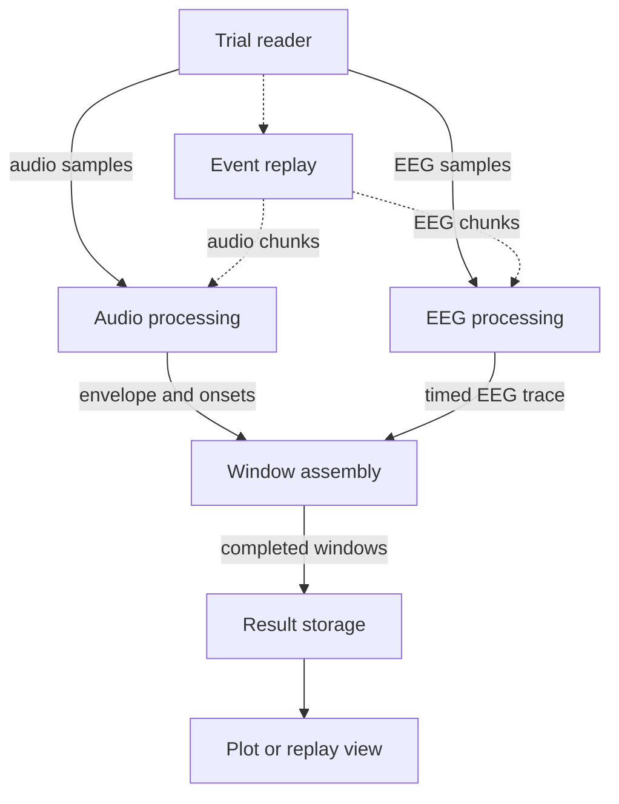

# 5. Building Block View

## 5.1 Raisync at a glance

The Signal Explorer will analyze one cached OpenMIIR listening trial on a laptop. The later Signal Observatory will add a replay publisher ahead of the same audio and EEG processors. Sharing those processors makes it possible to test whether delivering a recording in chunks changes the result. These are planned software modules that can run in one Python process.

Solid arrows show the offline path. Dashed arrows show how replay will deliver samples to the same processors.

| Building block | Responsibility and interface |
| --- | --- |
| Trial reader | Opens the cached stimulus audio, participant EEG file (FIF), and trial metadata. Selects the listening trial and maps each signal’s sample positions to seconds from the start of the musical excerpt, accounting for cue clicks. Passes the timing marker, offset, and uncertainty to the analysis. If the marker cannot be established, it reports the alignment problem. |
| Audio processing | Takes audio samples and their sampling rate. Produces a time-stamped amplitude envelope and one timestamp per detected musical onset. Carries detector state across chunks so a note attack spanning two chunks is counted once. |
| EEG processing | Takes EEG samples, channel metadata, and the requested channel. Returns that channel’s values, units, and trial-relative timestamps. Preserves the EEG sampling rate and carries any configured filter’s state across chunks. |
| Event replay | Reads the trial in recording order and releases each chunk when the replay clock reaches its end. Each chunk identifies the trial, signal, sample range, and recording time. The first milestone reads directly from the trial reader. A Kafka-compatible broker remains an option if publisher and processor later run separately. |
| Window assembly | Groups both processors’ outputs by trial and recording-time interval. A window is complete once both streams cover it and the onset detector has received the samples it needs to confirm events. The offline and replay paths apply the same end-of-trial rule. |
| Result storage | Saves completed windows and run metadata locally. Exposes the offline reference and each replay run separately so a reviewer can compare them. |

The local command line selects the trial and channel and renders the reference plot. The later browser view reads completed replay windows and shows processing delay separately from recording time. Public audio playback follows the [dataset constraints](02-constraints.md#23-dataset-licensing).

## 5.2 Window and storage interfaces

**Window boundaries.** A window includes its start and excludes its end. An onset at exactly 2.000 seconds belongs to the window beginning at 2.000 seconds, even if the detector confirms it in the next chunk. The EEG samples keep their own timestamps on that timeline. Comparing the two signals therefore does not require one EEG value per audio sample.

**Run storage.** Source recordings stay in the local input cache. Each run saves its source identifiers, selected channel, alignment evidence, code version, and analysis settings alongside its numerical windows. The Signal Explorer also saves the plot. The numerical windows are the reference for replay comparisons.

**Retry and comparison.** Storage identifies a result by run, trial, channel, and window boundaries. Restarting an interrupted replay from the beginning reuses its run ID and replaces the corresponding windows. Comparing a replay with the offline reference pairs windows across their two run IDs by trial, channel, and boundaries, then checks onset counts and numerical values as defined in the [solution strategy](04-solution-strategy.md#43-verify-the-transition).
