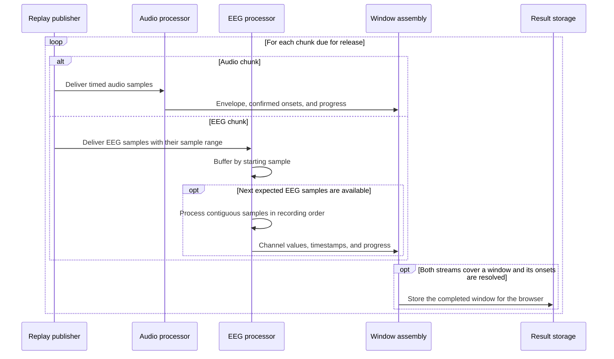

# 6. Runtime View

These scenarios describe the planned Signal Observatory replay of one recorded OpenMIIR listening trial. The first milestone, the offline Signal Explorer, produces the reference windows from the same cached files, channel, and analysis settings. A reviewer can then replay the trial locally and check the results against that reference. [Solution strategy](04-solution-strategy.md)

## 6.1 Replay a recording at its original pace

A reviewer selects a trial and channel. The trial reader uses the metadata revision for that participant to check which stimulus and cue were used in the listening trial. It locates the start of the music in the matched stimulus and EEG recording, maps both signals to that common time zero, and records the timing uncertainty. If the files disagree or the evidence cannot establish the start, the reader reports the problem and stops before publishing samples.

At 1× speed, the publisher releases each chunk when the replay clock reaches the end of its recorded interval. Each chunk carries the trial, signal, sample range, and recording time. The sequence shows how the [building blocks](05-building-block-view.md) turn those chunks into a result the browser can read.

After receiving the full expected audio range, the detector resolves pending onsets using the recorded samples. When both streams end, window assembly checks coverage against the expected ranges. It reports the signal and range for any gap and marks the run incomplete. With full coverage it publishes any remaining windows, including a partial one if the music ended between boundaries. [Window and storage interfaces](05-building-block-view.md#52-window-and-storage-interfaces)

## 6.2 Synchronize a window when EEG arrives late

Event time is a sample’s position in the recording. Replay elapsed time measures how long the run has been playing. When an EEG chunk arrives ahead of a gap, the EEG processor buffers it before filtering. Its filter state and the progress it reports to window assembly advance only when it can process the next contiguous samples in recording order.

Suppose the window spans **1.500 to 2.000 seconds**, including its start and excluding its end. The times below illustrate one possible 1× replay.

| Replay elapsed time | What happens | Effect on the window |
| --- | --- | --- |
| 2.000 s | The window reaches its scheduled end. Its final EEG chunk is delayed. | The window stays open. |
| 2.080 s | Later audio samples let the detector confirm an onset at recording time 1.960 s. | The onset belongs to this window. EEG coverage is still incomplete. |
| 2.100 s | The next EEG chunk arrives ahead of the delayed one. The EEG processor buffers it. | Filter state and reported EEG coverage stay at the start of the gap. |
| 2.250 s | The delayed EEG chunk arrives. The processor filters it, then the buffered chunk, in recording order. | EEG now covers the window. With its onsets resolved, window assembly finalizes it. |
| 2.300 s | The completed result becomes available to the browser. | The measured delay is **300 ms**, including detector look-ahead, the wait for EEG, and result delivery. |

An onset at exactly 2.000 s belongs to the next window. At 1× speed the target is for at least 95% of window results to be available within one second of their scheduled end. [Quality goals](01-introduction-and-goals.md#12-quality-goals)

## 6.3 Recover after a processor interruption

1. **Interrupt the run.** A reviewer stops the processor just after it writes one window, with the next window still in memory. The first write may already be durable even if the processor never acknowledged it.
2. **Rebuild from the beginning.** Restart the short trial with the same replay run ID, source files, channel, and settings. Replaying from time zero reconstructs the onset detector, EEG filter state, and partially assembled windows from the samples.
3. **Replace on retry.** Result storage writes each completed window under the key `(run ID, trial, channel, window start, window end)`. Reprocessing a stored window replaces that entry. The offline reference has its own run ID.
4. **Verify the recovered run.** Compare its window keys with an uninterrupted replay and its values with the offline reference, matching across runs by trial, channel, and boundaries. Each expected window must appear once, onset counts must match exactly, and numerical features must agree within their documented tolerances. [Window and storage interfaces](05-building-block-view.md#52-window-and-storage-interfaces)
