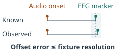
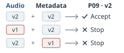
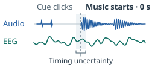
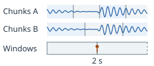
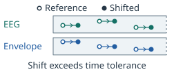
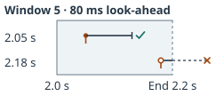
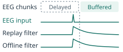
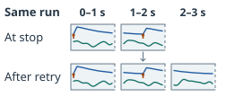

# 10. Quality Requirements

The offline Signal Explorer must establish timing accuracy and reproducibility for one OpenMIIR listening trial. The later Signal Observatory must also preserve that result during replay, deliver windows on time, and recover from interruption. These are acceptance criteria for the planned system. [Quality goals](01-introduction-and-goals.md#12-quality-goals)

## 10.1 Accuracy

| Scenario | Pass condition | Diagram |
| --- | --- | --- |
| Recover a known offset. Generate an audio onset and an EEG marker a known interval apart. | The absolute difference between the recovered and known intervals is at most the fixture’s declared timing resolution. Set that bound before the test using the sample rates and the onset detector’s time step. Report the expected offset, observed offset, and error in milliseconds. |  |
| Give the reader a P09 trial with v2 inputs, then replace the audio or stimulus metadata with v1 for the same excerpt. | The reader accepts the matched v2 inputs. Each substitution produces a revision mismatch before either mode emits aligned results. |  |
| Align a real listening trial. | The plot and run metadata identify the marker or offset used to locate the start of the music after the cue clicks. They state the timing uncertainty, or label it unknown if the source does not quantify it. If the excerpt start cannot be established, the run reports why and produces no aligned result. |  |
| Replay the reference trial with different chunk sizes, including a split through an onset. | Window boundaries and the counts of onsets, EEG samples, and envelope frames match exactly. Compare the onset times and each ordered series of (trial-relative timestamp, value) pairs using tolerances set before comparison. An onset exactly at a window boundary appears once, in the window that starts there. |  |
| Shift only the stored EEG timestamps in one replay window, then repeat with only its envelope timestamps shifted. Choose a shift larger than the timestamp tolerance that keeps every point within the window. | The comparison fails for the shifted series in each case, even though the values, counts, and window boundaries agree. |  |
| End a 2.2 s excerpt with 0.5 s windows and an onset detector that needs 80 ms of look-ahead. Include two otherwise detectable attacks at 2.05 s and 2.18 s. | Both modes produce five windows. The last spans `[2.0, 2.2)` and contains only the 2.05 s onset. Repeating with an excerpt ending at exactly 2.0 s produces four windows. |  |

The synthetic fixture checks timing against a known answer. Agreement on the real trial checks whether incremental processing preserves the offline calculation. Evidence of a repeatable EEG response to music requires the separate cross-trial analysis described in [chapter 1](01-introduction-and-goals.md#11-requirements-overview).

## 10.2 Latency

Run the cached trial locally at **1× replay speed**. For each expected window, measure elapsed time from its scheduled end until its completed result is available to the browser. Use a common monotonic time base for both readings. The measurement includes detector look-ahead, waiting for delayed EEG samples, processing, and delivery. A window ending at 2.000 s and available at 2.300 s has 300 ms of latency. [Runtime example](06-runtime-view.md#62-synchronize-a-window-when-eeg-arrives-late)

**Pass condition.** At least 95% of expected windows are available within **1.000 s** of their scheduled end. Count windows from the verified excerpt duration and configured window length. A clipped final window counts once and its scheduled end is the excerpt end. Report the number on time, the number expected, and the replay settings and laptop used. A missing window counts as a missed deadline and also fails the completeness check below.

## 10.3 Reliability

| Fault introduced during replay | Pass condition | Diagram |
| --- | --- | --- |
| Enable a stateful EEG filter and delay a chunk until its successor arrives. Use an impulse in the delayed chunk whose filter response extends into the successor. | The affected window stays open until both signals cover it and its onsets are resolved. After the gap closes, filtered values and timestamps in both chunks match the offline reference. If the chunk never arrives, the run identifies the missing signal and sample range and finishes with an incomplete status. |  |
| Stop the processor immediately after a window is written and before that write is acknowledged. | Restart from the beginning with the same run ID, inputs, and settings. After recovery, every expected window appears exactly once, with zero missing or extra windows. Onset counts match an uninterrupted replay exactly and numerical values meet the accuracy tolerances. The offline reference remains available under its own run ID. |  |

Verify the final stored results by trial, channel, and window boundaries. Row counts alone can hide a missing window if another was written twice. [Recovery scenario](06-runtime-view.md#63-recover-after-a-processor-interruption)

## 10.4 Reproducibility

A second reviewer starts from a clean checkout, installs the locked dependencies, and caches the specified source files. With the network disconnected, they run the documented local command using the same trial, EEG channel, and settings. [Local-first constraints](02-constraints.md#21-local-first-execution)

**Pass condition.** The reviewer regenerates the reference windows and synchronized plot. Window identities and event counts match exactly, numerical values and timestamps satisfy the accuracy criteria, and the plot shows the same channel, time origin, and onset positions. The saved run metadata identifies the dataset version and source files, participant and trial, verified stimulus revision, alignment marker and offset, code revision, dependency lockfile, and analysis settings. Those details let a reviewer trace a difference back to the inputs, software, or configuration.
